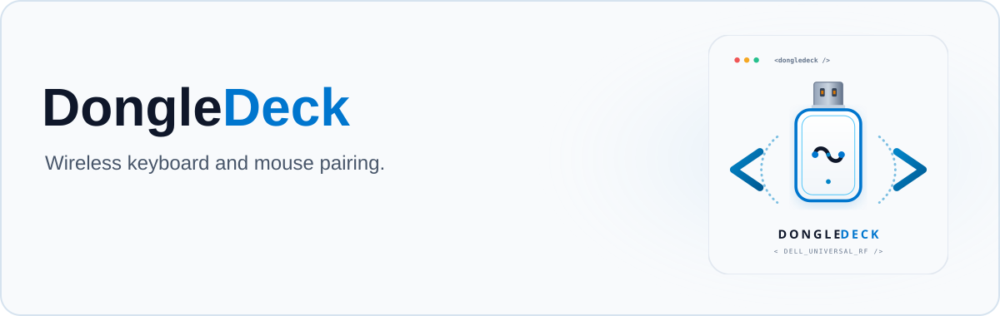

<picture>
  <source media="(prefers-color-scheme: dark)" srcset="src/assets/github/banner-dark.svg">
  
</picture>

# DongleDeck Prime

Pair and manage **Dell Universal**, **Logitech Unifying**, **Jabra Link** USB receivers, and **Windows Bluetooth** audio headsets from one portable Windows app — with built-in **Workstation Combo Locking** for IT support desks.

**[Download latest release](https://github.com/4guilera/DongleDeckPrime/releases/latest)** — grab `DongleDeck.exe` (or the portable ZIP) and run. No installer, .NET runtime, or vendor pairing suite required.

Windows 10/11 x64. Built as a self-contained single-file `DongleDeck.exe`.

Admin is only needed when Dell's DDPM service is running. The app shows its status; close DongleDeck Prime and use **Run as administrator** for Dell receivers. Logitech, Jabra, and Windows Bluetooth remain available without elevation.

## Features

- **Dell Universal & Logitech Unifying**: Automatic or manual keyboard and mouse pairing, battery, live activity, and individual/bulk unpair.
- **Jabra Link USB Dongles (Link 370 / 380 / 390 / 400)**:
  - Scan for nearby Jabra headsets and earbuds (Evolve2, Engage, Elite, etc.) in pairing mode and pair directly to Jabra Link Bluetooth dongles.
  - Connect, disconnect, remove, or clear paired headsets on the dongle.
  - Cabled USB pairing support for Jabra Link 400 DECT dongles + Engage DECT headsets.
  - Background detection of Jabra Direct conflicts.
- **Windows Bluetooth Audio**:
  - Pair Jabra headsets/earbuds directly to the PC's built-in Windows Bluetooth radio (with a **Jabra only** filter toggle to also support any Bluetooth audio headset).
  - Unpair and trigger reconnect directly from the app.
- **Workstation Combo & Receiver Lock**:
  - **Lock my combo**: Move your workstation mouse and press a key on your keyboard to automatically claim and lock your personal keyboard, mouse, and receiver with your owner label (e.g., `Paul's Workstation`).
  - Locked devices show a lock badge (`🔒 Owner`), disable **Remove**, and are skipped automatically when clicking **Clear unlocked**.
  - Locked receivers show clearly in the dropdown (`🔒 [Owner] Dell Universal Receiver 1`) and block pairing, removing, and clearing until explicitly unlocked.
  - Plugging in an end-user's unlocked dongle automatically selects it so your workstation receiver stays untouched.
- **Dark and light modes**, automatic USB hotplug detection.

## Hardware and protocols

| Receiver / Radio | USB ID / Transport | Protocol |
| --- | --- | --- |
| Dell Universal | `413C:301C` | Dell HID management |
| Logitech Unifying | `046D:C52B` | HID++ 1.0 |
| Jabra Link 370 / 380 / 390 | `0B0E:*` | Jabra .NET SDK (`DevicePairing` Bluetooth) |
| Jabra Link 400 (DECT) | `0B0E:*` | Jabra .NET SDK (`DevicePairing` DECT USB) |
| Windows Bluetooth | Built-in PC Bluetooth Radio | Windows Runtime (`Windows.Devices.Bluetooth`) |

## Build

Requires the [.NET 8 SDK](https://dotnet.microsoft.com/download/dotnet/8.0) on Windows x64:

```powershell
.\build.ps1          # Single-file self-contained EXE in dist/
.\build.ps1 -Test    # Protocol, lock-store, and Jabra classifier tests
.\build.ps1 -Package # ZIP containing the EXE and license (+ SHA-256)
```

MIT licensed (Jabra .NET SDK packages are Apache-2.0 licensed). Dell protocol reference: [dell-rf](https://github.com/michaelknap/dell-rf). Logitech: [HID++ specification](https://lekensteyn.nl/files/logitech/logitech_hidpp10_specification_for_Unifying_Receivers.pdf). Independent of Dell, Logitech, and Jabra.
