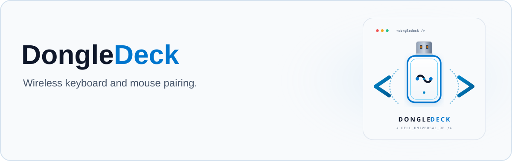

<picture>
  <source media="(prefers-color-scheme: dark)" srcset="src/assets/github/banner-dark.svg">
  
</picture>

# DongleDeck

Pair keyboards and mice to USB wireless receivers.

**[Download](https://github.com/bcocanig/DongleDeck/releases/latest)** — extract and run `DongleDeck.exe`. No installer or Dell/Logitech software needed.

Windows 10/11 x64, .NET Framework 4.8+. All app resources are inside the EXE.

Admin is only needed when Dell's DDPM service is running. The app shows its status; close DongleDeck and use **Run as administrator** for Dell receivers. Logitech remains available without elevation. The service is stopped temporarily and restored after each Dell operation.

## Features

- Automatic keyboard and mouse pairing.
- Continuous scanning until **Stop pairing** or the receiver is full.
- Remove individual devices or clear a receiver.
- Automatic receiver detection on plug/unplug.
- Battery and recent activity, when available.
- Dark and light modes.

## Hardware and protocols

| Receiver | USB ID | Protocol | Status |
| --- | --- | --- | --- |
| Dell Universal | `413C:301C` | Dell HID management | Tested: revision 0244, KB740, MS5320W |
| Logitech Unifying | `046D:C52B` | HID++ 1.0 | Pairing tested: revision 1209 |

Other receivers, including Logitech Bolt and Lightspeed, are not enabled.

## Pair

1. Select the receiver and click **Start pairing**.
2. Dell: choose the blue receiver channel; power off, hold a key/button, and power on.
3. Logitech: power the device off and on near the receiver.
4. Repeat for the second device, then click **Stop pairing**.

**Remove** and **Clear pairings** take effect immediately.

## Build

```powershell
.\build.ps1          # EXE in dist/
.\build.ps1 -Test    # Simulated protocol tests
.\build.ps1 -Package # ZIP containing the EXE and license
```

Uses Windows' .NET Framework compiler; no package downloads.

MIT licensed. Dell protocol reference: [dell-rf](https://github.com/michaelknap/dell-rf). Logitech: [HID++ specification](https://lekensteyn.nl/files/logitech/logitech_hidpp10_specification_for_Unifying_Receivers.pdf). Independent of Dell and Logitech.
