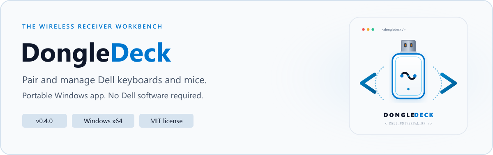
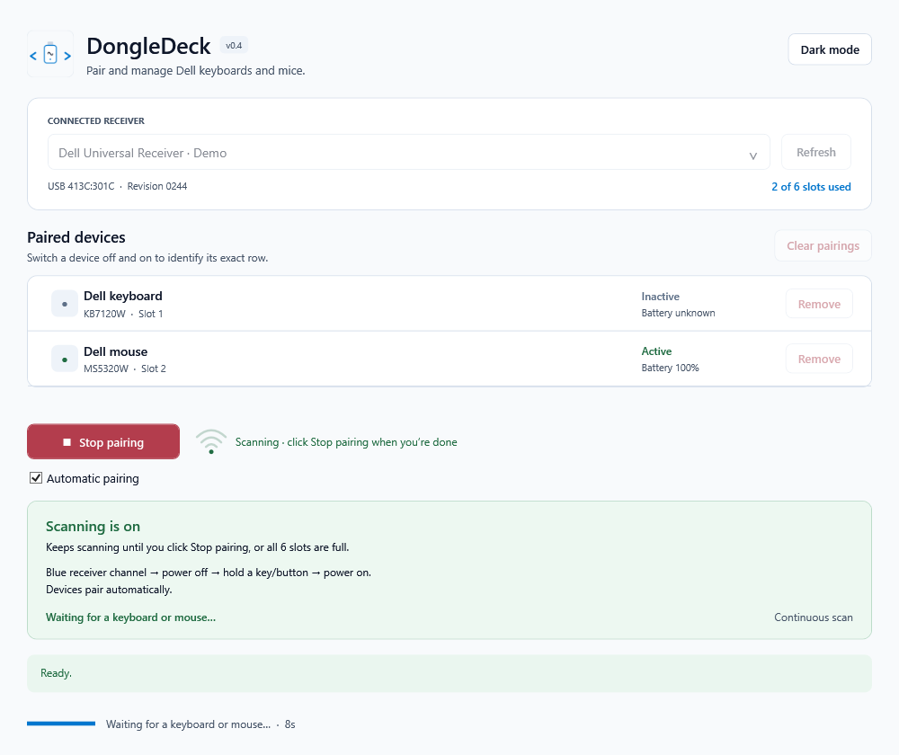

<picture>
  <source media="(prefers-color-scheme: dark)" srcset="assets/github/banner-dark.png">
  <source media="(prefers-color-scheme: light)" srcset="assets/github/banner-light.png">
  
</picture>

# DongleDeck

**Pair Dell keyboards and mice, clear old pairings, and get the next combo ready.**

[](https://github.com/bcocanig/DongleDeck/actions/workflows/build.yml)
[](LICENSE)

**[Download for Windows](https://github.com/bcocanig/DongleDeck/releases/latest)** · [Supported hardware](#supported-hardware) · [Troubleshooting](docs/TROUBLESHOOTING.md) · [30 feature ideas](docs/ROADMAP.md)

## Get started

1. Download **DongleDeck-v0.4.0-win-x64.zip** from [Releases](https://github.com/bcocanig/DongleDeck/releases).
2. Extract it to a folder. Keep `DongleDeck.exe` and its `.config` file together.
3. Open **DongleDeck.exe** and approve the administrator prompt.

**No installer or Dell software required.** Runs on Windows 10/11 x64 with .NET Framework 4.8 or newer. Windows 11 and Windows 10 22H2 already include a suitable runtime; see [Microsoft's version table](https://learn.microsoft.com/en-us/dotnet/framework/install/on-windows-10).

No Python, Node, .NET SDK, replacement USB driver, or Internet connection is needed. The current executable is unsigned, so Windows may show an unknown-publisher or SmartScreen notice.

## Pair a keyboard and mouse

1. Plug in the receiver, click **Refresh**, and select the intended dongle.
2. Leave **Automatic pairing** checked and click the green **Start pairing** button.
3. Select the device's blue receiver channel. Power it off, hold a key or mouse button, then power it on.
4. Wait for the device to appear in the paired list. Repeat with the other device.
5. Click the red **Stop pairing** button when the combo is ready.

**Scanning keeps running until you click Stop pairing or all six slots are full.** Animated radio waves show that it is on. Pairing one device does not end the search. An already-started pairing finishes its verification before stopping.

Uncheck **Automatic pairing** to choose discovered devices manually. The footer shows the current operation and elapsed time while the receiver works.

<picture>
  <source media="(prefers-color-scheme: dark)" srcset="docs/dark-mode.png">
  <source media="(prefers-color-scheme: light)" srcset="docs/light-mode.png">
  
</picture>

<sub>Interface preview with example devices. Use the top-right button to switch themes; your choice is remembered.</sub>

## Manage the receiver

| Action | What happens |
| --- | --- |
| **Remove** | Forgets that device and refreshes the list immediately |
| **Clear pairings** | Removes every stored device from the selected receiver, one slot at a time |
| **Active / Seen / Inactive** | Shows observed activity; power-cycle a device to help identify its row |
| **Battery** | Displays charge when available; the value may be cached |

Remove and Clear work without confirmation dialogs. Clear disconnects the paired devices; it does not reset firmware. Each change is read back and verified.

Activity is an observation, not a guaranteed range test. A battery reading alone never marks a device active. The input monitor reads routing headers, without reading or recording typed characters or mouse input payloads.

## Supported hardware

| Hardware | Status |
| --- | --- |
| **Dell Universal Receiver — USB 413C:301C** | Enabled; revision **0244** physically tested |
| **Dell KB740** | Pairing tested; may report the internal name `KB7120W` |
| **Dell MS5320W** | Pairing, battery, and activity tested |
| Other Dell USB IDs, including 413C:4503 | Not enabled |
| **Logitech Unifying** | Planned next; not supported in this release |
| Logitech Bolt / Lightspeed | Not supported |

The receiver's USB ID determines support; the blue link icon alone is not enough. Up to six compatible devices can be stored on one receiver. When several dongles are attached, operations use the selected receiver.

## How it works

DongleDeck sends USB HID management commands to the receiver. The receiver's own firmware handles discovery, the wireless handshake, and stored pairings. No Dell SDK or DLL is included.

The starting point was Michael Knap's [dell-rf protocol research](https://github.com/michaelknap/dell-rf/blob/main/docs/PROTOCOL-4503.md). This original Windows implementation was separately tested on the supported hardware. When Dell's `DPMService` holds the management interface, DongleDeck pauses it for the operation and restores it afterward.

Read the [protocol and architecture notes](docs/PROTOCOL.md) for commands, attribution, and limitations.

## Build and contribute

```powershell
.\test.ps1
.\build.ps1
.\pack.ps1
```

Uses the C# compiler included with Windows' .NET Framework. **No NuGet packages or additional build tools.** The 21 protocol/status tests use a simulated receiver and do not modify physical hardware.

- [Contributing and hardware testing](CONTRIBUTING.md)
- [Troubleshooting and log locations](docs/TROUBLESHOOTING.md)
- [30 practical feature proposals](docs/ROADMAP.md)
- [Release notes](CHANGELOG.md)
- [Brand assets](assets/README.md)

MIT licensed. Independent of Dell and Logitech. See [LICENSE](LICENSE) and [acknowledgements](THIRD-PARTY-NOTICES.md).
